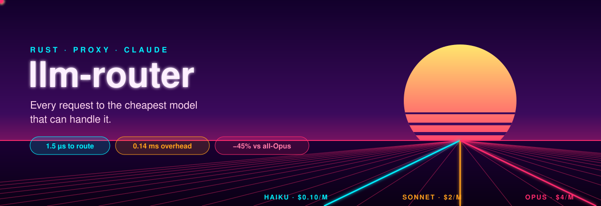
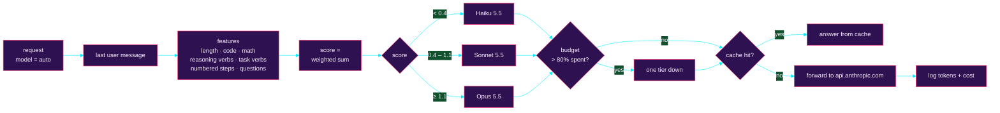
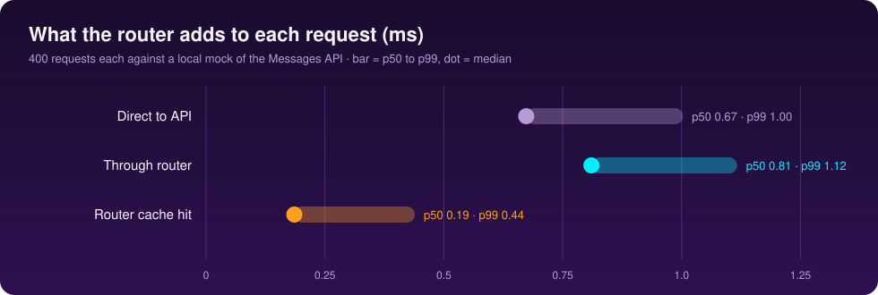

<p align="center"></p>

<p align="center">


</p>

<p align="center"><i>"What's the capital of Japan?" does not need the same model as "design a fraud-detection system for 50,000 transactions per second."</i><br>
<b>llm-router</b> is a tiny local proxy that reads each request, scores how hard it is, and sends it to Haiku, Sonnet or Opus.<br>Your code changes one line: the base URL.</p>

---

## ▸ Drop-in

```bash
git clone https://github.com/jafarSalim/llm-router-rs.git && cd llm-router-rs
cargo build --release
./target/release/llm-router serve --daily-budget 20
#  llm-router listening on http://127.0.0.1:8787  (send model = "auto")
```

```python
import anthropic
client = anthropic.Anthropic(base_url="http://127.0.0.1:8787")   # the only change
msg = client.messages.create(model="auto", max_tokens=1024,
                             messages=[{"role": "user", "content": "Translate 'good morning' into Spanish."}])
```

Every response carries headers that tell you what happened:

```http
x-router-model: claude-haiku-5-5
x-router-score: -0.84
x-router-cache: miss
x-router-cost-usd: 0.000057
```

Send a real model name instead of `"auto"` and the router passes it through untouched. `GET /stats` returns requests per model, cache hits, money spent, and what the same traffic would have cost on Opus.

---

## ▸ How it decides



The classifier is a transparent weighted sum, written out in [`src/lib.rs`](src/lib.rs). No model is called to make the decision, so routing costs nothing and takes about a microsecond:

$$\text{score} = 0.9\ln(1+\text{tokens}) + 1.6\,[\text{code}] + 2.2\,[\text{math}] + 0.75\min(r,5) + 0.6\min(t,3) + 0.25\min(s,6) + 0.3\min(q-1,3) - 3$$

with $r$ reasoning verbs (*design, analyze, trade-offs, optimize, prove* …), $t$ task verbs (*write, explain, implement* …), $s$ numbered steps and $q$ question marks.

---

## ▸ Measured

### Accuracy, on prompts it never saw

I wrote and labeled **90 prompts** (30 easy, 30 medium, 30 hard; [`data/prompts.jsonl`](data/prompts.jsonl)). The two thresholds were tuned on the 45 prompts with odd numbers, then frozen and tested on the 45 with even numbers. Missing a hard prompt by sending it to Haiku counted three times as bad as any other mistake.

<p align="center"></p>

| label ↓ · routed to → | Haiku | Sonnet | Opus |
|---|:---:|:---:|:---:|
| **easy** | 15 | 0 | 0 |
| **medium** | 2 | 5 | 8 |
| **hard** | 0 | 0 | 15 |

* **78%** of test prompts went exactly where the label said (89% on the tuning half).
* **No hard prompt went to Haiku**, and every easy prompt stayed on Haiku.
* The weak spot is the middle: 8 of 15 medium prompts were sent up to Opus. That is the safe direction to be wrong in: it costs money, not quality.

<p align="center"></p>

### Cost

Prices: Haiku 5.5 $0.10 / $0.50, Sonnet 5.5 $2 / $10, Opus 5.5 $4 / $20 per million input / output tokens ([pricing](https://platform.claude.com/docs/en/about-claude/pricing), checked 2026-11-09). Answer lengths assumed per label: 150, 600 and 1,500 output tokens.

<p align="center"></p>

| Traffic | easy / medium / hard (%) | Always Opus | Router | Perfect labels | Always Sonnet |
|---|:---:|:---:|:---:|:---:|:---:|
| Chat app | 70/25/5 | $6.67 | **$3.69** (45% less) | $3.08 | $3.33 |
| Coding assistant | 30/50/20 | $13.01 | **$10.32** (21% less) | $9.09 | $6.50 |
| Research assistant | 10/40/50 | $20.24 | **$18.51** (9% less) | $17.53 | $10.12 |

How to read this honestly:

* Against **always using the strongest model**, the router saves **45%** on chat-style traffic and still 9% on research traffic, while every hard prompt still reaches Opus.
* **Always Sonnet** is cheaper still, but it sends your hardest prompts to a smaller model. The router costs a little more than that because it pays for Opus where the label says it is needed, and because it over-routes some medium prompts.
* **Perfect labels** is the floor any router could reach with these prices. On chat traffic the router is within $0.62 of it per thousand requests.

### Speed

<p align="center"></p>

| | p50 | p99 |
|---|:---:|:---:|
| Classifying one prompt (Rust, release build) | **1.46 µs** | |
| Request straight to a local API mock | 0.67 ms | 1.00 ms |
| Same request through the router | 0.81 ms | 1.12 ms |
| Repeated request, served from the router's cache | 0.19 ms | 0.44 ms |

The router adds about **0.14 ms** to a request; a real model answer takes seconds. Classifier throughput: **685k prompts per second** on one core.

---

## ▸ Options

```text
llm-router serve [--listen 127.0.0.1:8787] [--upstream https://api.anthropic.com]
                 [--daily-budget USD] [--cache-ttl-secs 600] [--cache-size 1000]
                 [--sonnet-threshold 0.4] [--opus-threshold 1.1]
llm-router route data/prompts.jsonl      # one routing decision per line, with the features
llm-router bench data/prompts.jsonl      # classifier throughput
```

**Budget.** With `--daily-budget 20`, once $16 (80%) is spent every request moves one tier down; at $20 the router answers HTTP 402 instead of forwarding.
**Cache.** Exact-match on the final request body (SHA-256), with a time-to-live and a size cap. Only use it where an identical answer to an identical request is what you want.

## ▸ Inside

```text
llm-router-rs/
├── src/
│   ├── lib.rs          features, score, tiers, prices, budget, cache (7 unit tests)
│   ├── server.rs       axum proxy: route → cache → forward → account
│   └── main.rs         serve / route / bench
├── tests/proxy.rs      3 end-to-end tests with a mock Anthropic API
├── data/prompts.jsonl  90 hand-labeled prompts
├── scripts/
│   ├── evaluate.py     threshold tuning on one half, test on the other, cost by traffic mix
│   ├── latency.py      overhead against a local mock
│   └── charts.py       the SVG charts in this README
└── results/            eval.json, latency.json, bench.json, charts
```

```bash
cargo test                      # 10 passing
python3 scripts/evaluate.py     # needs the release build
python3 scripts/latency.py
python3 scripts/charts.py
```

## ▸ Limits

* The labels are mine. Difficulty is a judgment; tune the thresholds on your own traffic with `scripts/evaluate.py`.
* 90 prompts are enough to show the method, not to promise a number on your workload.
* Streaming responses are not supported yet (the router answers 400 to `"stream": true`).
* The cost model assumes typical answer lengths; real savings depend on how long the answers to your hard prompts are.
* The token count used for scoring is an estimate (4 characters per token), which is fine for routing but not for billing; billing uses the `usage` field the API returns.

---

<p align="center"><b>Eng. Jaafar Salim</b> · University of Technology, Iraq · <a href="https://github.com/jafarSalim">github.com/jafarSalim</a><br>
Route small questions to small models. If this saved you money, a ⭐ helps others find it.</p>
